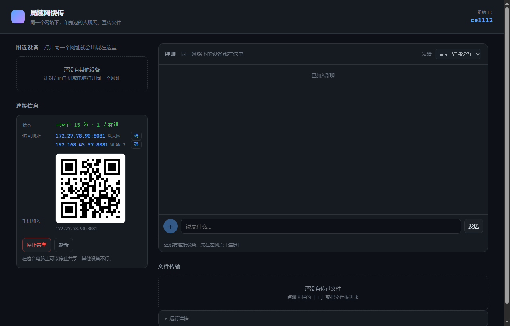

# 局域网快传

**不经过互联网**的点对点文件传输 + 局域网群聊。同一网络下的设备打开同一个网址，就能在同一个房间里聊天、互传文件。


---

> **关于本项目**
>
> 本项目由 **DeepSeek** 在已有 P2P 局域网传输开源项目的基础上二次开发所得。
>
> 原项目传输大文件（超过 500 MB）会失败——接收端先把整个文件塞进内存，最后「保存」一步被撑爆。本版重写了传输与保存链路，GB 级文件也能稳定送达。



## 特性

- **点对点传文件** —— WebRTC DataChannel 直连，文件不经过任何服务器；只用局域网内自建的 STUN 打洞，不依赖公网服务
- **局域网群聊** —— 打开页面即进入同一房间，消息广播给所有人，**无需先建立连接**
- **大文件可靠** —— 手机接收 ≥200 MB 时自动切换「直链下载」，交给浏览器原生下载器：可暂停续传、不占内存、锁屏也能下
- **开箱即用** —— 发行包内置 Node 运行时，双击 `start.bat` 即可，目标机器无需安装 Node
- **手机扫码加入** —— 页面内展示二维码，扫一扫直接进入

## 快速开始

### 方式一：发行包（推荐）

解压后双击 `deploy.bat`（首次使用，自动提权放行防火墙），之后日常用 `start.bat` 启动、`stop.bat` 停止。

### 方式二：从源码运行

```bash
npm install
npm start          # 默认 http://localhost:8081
```

### 系统要求

- Windows 10 / 11（批处理脚本与防火墙配置按 Windows 编写）
- 发行包已内置 Node 运行时；源码运行需 Node.js 18+
- 浏览器建议 Chromium 内核：Chrome / Edge / QQ 浏览器（微信内置浏览器对 WebRTC 支持不稳定）

## 使用

1. 启动后浏览器自动打开页面；左侧「连接信息」里有二维码和访问地址
2. 其他设备（手机 / 电脑）扫码或打开同一地址
3. **聊天**：输入后回车，房间内所有人可见
4. **传文件**：先在左侧点「连接」建立直连，再点聊天栏的「＋」选择文件，或把文件直接拖进聊天栏

## 工作原理

```
浏览器 A ──WebSocket 信令── 服务器（跑在其中一台机器上）
   │                            │
   └── WebRTC DataChannel ──────┘   同局域网直连，文件不经服务器
```

- **信令**：局域网 WebSocket，按来源 IP 分组，同网段即同一房间
- **打洞**：内置约 20 行 STUN（UDP 3478），避免浏览器把局域网地址写成 mDNS 名称导致跨设备连不上
- **小文件**：WebRTC 点对点直传，分片 + 补发重传，进度不会超过 100%
- **大文件（≥200 MB，接收方为手机）**：改为「发送方流式上传到本机服务器 → 接收方用浏览器原生下载器拉取」。这是相对原项目最关键的改动：不再把整个文件堆在手机内存里，保存交给系统下载管理器，支持断点续传与锁屏下载；中转文件用完即删（并保留 10 分钟完成记录，避免手机后台节流时误判状态）

## 项目结构

```
├── start.bat / stop.bat / deploy.bat / fix-firewall.bat
├── server.js       静态托管 + 信令 + STUN + HTTPS + 中转接口
├── cert.js         零依赖自签证书生成
├── stop.js         停止服务
├── public/         前端（index.html / app.js / style.css / qrcode.js）
├── runtime/        便携版 Node（仅发行包内置，git 中忽略）
├── docs/           截图
└── VERSION
```

## 接口

| 接口 | 方法 | 说明 |
|---|---|---|
| `/api/info` | GET | 服务状态与可用地址 |
| `/api/shutdown` | POST | 停止服务（仅本机，需 `x-shutdown: 1`） |
| `/api/upload` | POST | 中转上传（大文件直链用，总量上限 8GB） |
| `/dl/:token` | GET | 中转下载，支持 Range 断点续传 |
| `/api/dl-status` | GET | 查询中转状态（含完成记录） |
| `/api/delete` | POST | 清理中转文件 |
| `/__diag` | GET | 网络连通性自检页 |

## 常见问题

**别的设备打不开页面？**
多半是 Windows 把当前网络判成了「公用」，防火墙拦截了入站。运行一次 `fix-firewall.bat`（放行 TCP 8081 / 8181、UDP 3478）。若连的是公共 WiFi 且开启了「设备隔离」，任何设置都无效，需要用手机热点自建局域网。

**手机该用哪个地址？**
用二维码里的 **http** 地址。https 是自签证书，手机浏览器能点「继续访问」打开，但系统下载器不认该证书，大文件下载会失败。

**为什么大文件不直接用 WebRTC？**
手机浏览器内存有限，GB 级文件容易卡在最后「保存」这一步。直链下载把保存交给系统下载管理器，稳定性最好。

**需要连公网吗？**
不需要。信令、STUN、中转全部跑在局域网内的那台机器上。

## 致谢

- 原始 P2P 局域网传输开源项目提供的思路与实现基础
- [qrcode-generator](https://github.com/kazuhikoarase/qrcode-generator)（MIT）用于前端二维码生成

## 许可

[MIT](LICENSE)
